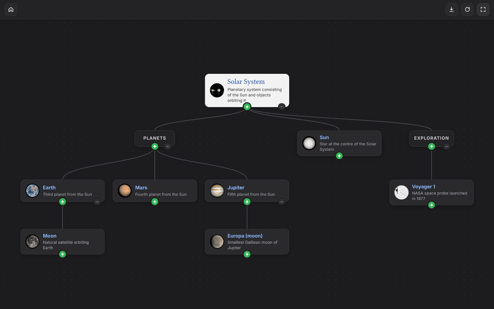
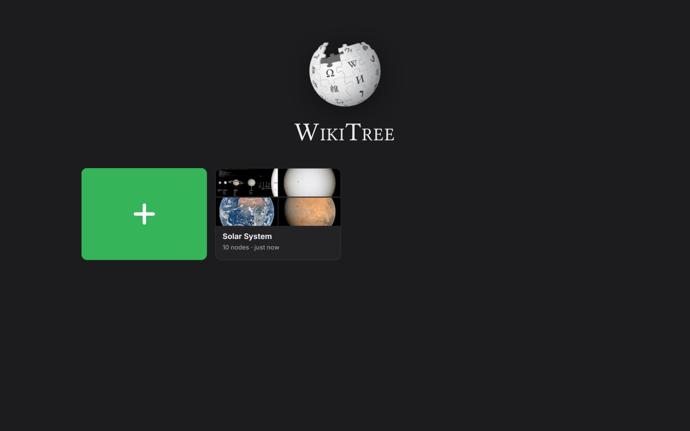
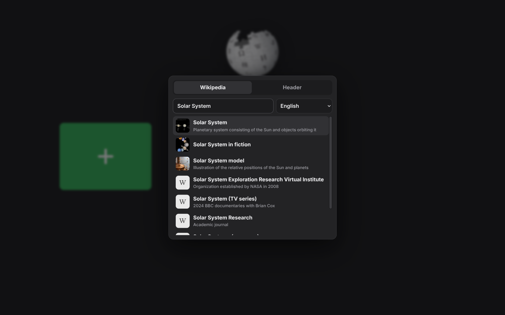
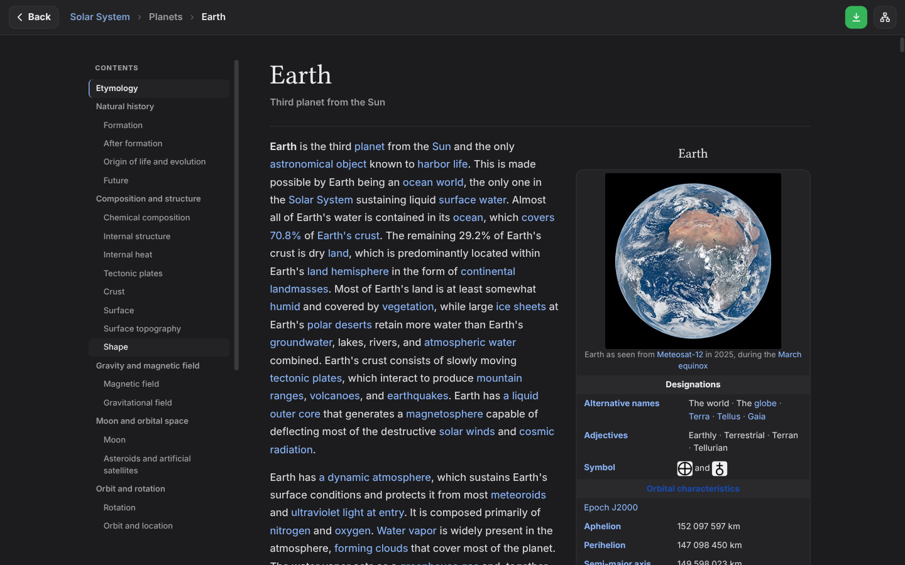

<p align="center">
  
</p>

<h1 align="center">WikiTree</h1>

<p align="center">
  Build trees of Wikipedia articles and read them without leaving the app.<br>
  Desktop app for Linux, Windows and macOS. No account, no server — just Wikipedia.
</p>

<p align="center">
  <a href="https://github.com/boraned/wikitree/releases/latest">Download</a> ·
  <a href="#use">Use</a> ·
  <a href="#development">Development</a>
</p>



## Features

- **Trees of knowledge** — every project starts from one article or header; add children with the green **+**.
- **Read in place** — articles open inside the app without edit links, navboxes, citation markers,
  references, "see also" or external-link sections.
- **Links grow the tree** — clicking a blue link opens that article and adds it as a child of the one you're reading.
- **Free layout** — drag nodes anywhere; drop one onto another to re-attach it with its whole branch.
  Nodes that get too close glide apart.
- **30 languages** — search any of them; right-to-left languages are laid out correctly.
- **Offline when you choose** — download an article (or the whole project) with its images and read it without
  internet. Nothing else is kept: articles you only read are held in memory and gone when the app closes.
- **Always saved** — every change is written to disk immediately.

| | |
| --- | --- |
|  |  |
|  | |

## Download

Get the latest build from [Releases](https://github.com/boraned/wikitree/releases/latest):

| OS | File | How to open |
| --- | --- | --- |
| Windows | `WikiTree-<version>-Windows-x64.exe` | Double-click — no install. Unsigned, so SmartScreen may ask: *More info → Run anyway*. |
| macOS (M1–M4) | `WikiTree-<version>-macOS-AppleSilicon.zip` | Unzip, move *WikiTree* to Applications, open it. The first time macOS blocks it: *System Settings → Privacy & Security → Open Anyway*. |
| macOS (Intel) | `WikiTree-<version>-macOS-Intel.zip` | Same as above. |
| Linux | `WikiTree-<version>-Linux-x64.AppImage` | Make it executable (`chmod +x`) and run it. Some distros need `libfuse2`. |

Each is a single file with everything included; it only needs an internet connection for Wikipedia.

## Use

- **Main menu** — the green **+** card starts a project. Choose *Wikipedia* (search, pick a language)
  or *Header*. Click a project card to open it.
- **Tree** — **+** under a node adds a child. Drag a node to move it with its branch; drop it on another
  node to attach it there. Double-click a header to rename it; right-click for collapse and delete.
  Drag the background to pan, scroll to zoom. Top bar: download all · arrange · fit.
- **Reader** — **Back** is top-left. Blue links open and become children; green links are already children.
  Ctrl / middle-click adds a link without leaving the page. ↓ downloads the article for offline reading.
- **Download button** — green when there is something to download; normal colour and not clickable when
  everything is downloaded (✓) or there is no internet.

## Where data lives

The OS's per-user app folder: `~/.config/WikiTree` (Linux), `%APPDATA%\WikiTree` (Windows),
`~/Library/Application Support/WikiTree` (macOS).

```
projects/<id>/project.json   the tree
projects/<id>/pages/         downloaded articles
projects/<id>/media/         their images
settings.json                last search language
```

Nothing from Wikipedia is stored unless you download it. Pages and images you read are kept in memory
while the app runs; Chromium's own session files go to a temporary folder that is removed when the app
quits (any leftovers from a crash are removed on the next start).

Each change is written with an atomic replace. Several windows can be open at once: each edits its own
copy, and the window that changes something last overwrites the file. Set `WIKITREE_HOME` to keep the
data somewhere else (for example next to a portable copy).

## Development

Requires Node.js 20+.

```sh
npm install --include=dev
npm start                 # run from source
npm test                  # end-to-end tests against the real app (needs internet)
npm run test:offline      # + the same app with networking removed (Linux: unshare)
npm run screenshots       # regenerate docs/screenshots
npm run dist:linux        # AppImage   → dist/
npm run dist:win          # portable .exe → dist/
npm run dist:mac          # universal .dmg/.zip (run on a Mac)
npm run release           # all four release files → releases/ (on Linux; Mac apps ad-hoc signed)
```

Pushing a `v*` tag runs `.github/workflows/release.yml`, which builds all three platforms on native
runners and publishes a GitHub Release.

```
src/
  main/                    Electron main process
    index.js               window, wikitree:// protocol, menu, IPC
    projects.js            project files (create, save, delete, migrate)
    wikipedia.js           search, summaries, article HTML, namespaces (in-memory cache)
    offline.js             downloading articles + images for offline reading
    http.js                in-memory network session (nothing cached on disk)
    paths.js               data folders, ids, atomic writes
    preload.cjs            the small API the UI is allowed to call
  renderer/                UI (plain ES modules, no framework, no build step)
    app.js                 router
    views/                 home, tree, reader
    lib/                   store (state + saving), clean (article clean-up), modal, api, dom
    styles/                app.css, article.css
    assets/                fonts, images
tests/                     end-to-end tests (playwright-core driving Electron)
scripts/                   screenshots, Linux desktop install
build/icon.png             app icon used by electron-builder
```

## Credits

Article text comes from [Wikipedia](https://www.wikipedia.org/) under
[CC BY-SA 4.0](https://creativecommons.org/licenses/by-sa/4.0/) and is credited under every article.
WikiTree is an independent project, not affiliated with or endorsed by the Wikimedia Foundation.
Fonts and other third-party material: see [THIRD_PARTY_NOTICES.md](THIRD_PARTY_NOTICES.md).

## License

[MIT](LICENSE) © Boran Omeroglu
